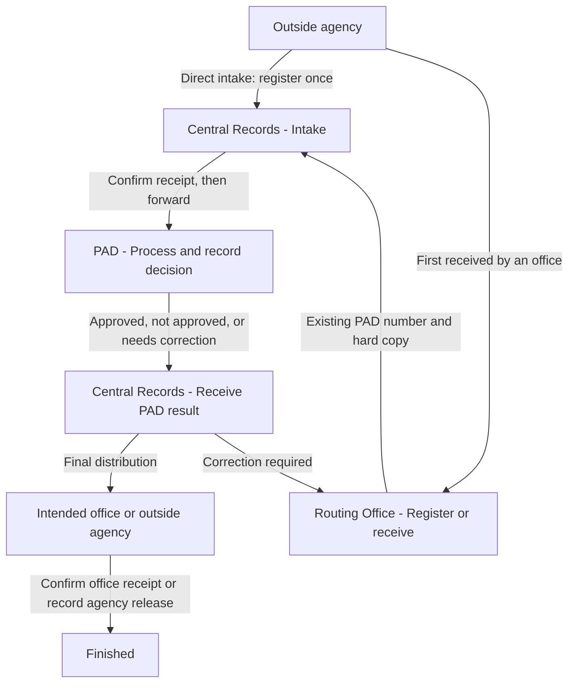

# Central Records and PAD implementation plan

This file is the reusable plan for future implementation prompts. Complete one phase at a time. The plan itself does not authorize starting implementation now.

## Agreed target

- Account roles remain **Administrator** and **Router**.
- Each office has a workflow designation: **Central Records**, **PAD**, or **Routing Office**. Assigned office determines the Router workspace and responsibilities.
- A new document can be encoded at Central Records or at the first receiving Routing Office. It receives one PAD file code.
- Routing Offices submit to Central Records. Only Central Records forwards to PAD. PAD sends every result back to Central Records. Central Records distributes the result to the intended office or records release to an outside agency.
- PAD outcomes are **Approved**, **Not approved**, or **Needs correction**. A PAD decision does not itself close routing.
- Corrections and resubmissions retain the existing file code and history.
- Every transfer requires the destination office to confirm physical receipt. Existing documents are not encoded again.
- PAD and Central Records have separate dashboards with statistics across all offices. Ordinary offices see statistics only for their own office's documents.
- University-wide reporting does not authorize acting on a document held by another office.



## Constraints to preserve throughout

- Work in `pad-api` and `pad-web`. Treat `sam.pad` as the reference system and source catalog; do not alter its application or database for this project.
- Preserve existing account roles, Google identities, office IDs, document IDs, file codes, attachments, and history.
- Preserve the simple Received card layout and its received date and encoder/receiver information.
- Keep registration simple: source, document type, particulars, applicable personnel and Travel Order details. Do not restore the removed separate subject, intended-final-office input, or registration file picker.
- Keep document files optional. Later upload remains available, including after signatories finish.
- Keep the imported document types, source catalog, and searchable personnel multiple selection.
- Separate the source agency/office from the receiving office, responsible office, current holding office, and final recipient.
- Source names imported from `tbldivisions` include internal and external entries. Do not classify all entries as agencies or infer classifications without evidence.
- Do not create or transfer real documents merely to verify a change. Use isolated fixtures for workflow checks and read-only browser previews for the real workspace.
- Use additive, repeatable migrations. Before applying data changes, preserve affected existing data using the project's backup process and keep backups outside version control.
- If implementation spans several prompts, keep incomplete mandatory workflow rules inactive until the full path and its UI are ready. A temporary configuration switch is one way to do this.
- Future phase prompts authorize only their named phase. Report unresolved dependencies and update this checklist rather than silently expanding into another phase.

## Progress checklist

| Phase | Main target | Status |
| --- | --- | --- |
| 1 | Validate baseline, office mapping, and routing contract | Complete (read-only review; mapping confirmed) |
| 2 | Implement office designations and permission boundaries | Not started |
| 3 | Add document metadata and safe migrations | Not started |
| 4 | Implement the complete server workflow | Not started |
| 5 | Add the office-specific user actions and review screens | Not started |
| 6 | Implement the three dashboard scopes and statistics | Complete (2026-10-10; current four-role model; shared OVP statistics and server-scoped office reports) |
| 7 | Review and prepare existing records for the new flow | Not started |
| 8 | Verify the complete flow and enable it | Not started |

Update Status only when the phase's completion checks are satisfied. Add a short implementation note with changed files, checks performed, and remaining limitations.

Phase 6 implementation uses the current four-role model described in `pad-review-decisions.md`, rather than the earlier office-designation proposal. See [document-statistics.md](document-statistics.md) for scope, counting definitions, access boundaries and validation. PAD and Central Records share all-office aggregates while their desk queues stay local; ordinary-office reports retain participation tracking and cannot override office scope. This does not mark the other original phases complete or import historical records.

## Phase 1 - Baseline and routing contract

**Finish first:** establish which real office is Central Records and which is PAD/President's Office, then document the exact rules before changing permissions or routing.

Work:

1. Read current routing, office administration, account roles, registration, and dashboard code in both projects.
2. Identify the existing Central Records and PAD office IDs/codes and their account assignments. Do not create duplicate offices or assign designation from a display name alone.
3. Record how existing documents represent source, first receiving office, current holder, pending destination, recipient, and decision history.
4. Produce the allowed-transition matrix for the agreed flow, including corrections and external release. Record whether a decision is final or requires resubmission.
5. Define the meaning of each proposed statistic and the adoption strategy for existing documents. This plan follows the diagram's route through Central Records and PAD; do not add a routine bypass in this phase.
6. List any missing office mapping or business rule that needs user input. Read-only inspection and documentation are the only changes in this phase.

Completion:

- The designated office mappings and transition matrix are recorded.
- Data gaps and legacy-document cases are identified.
- No application code, account assignment, or document data has changed.

Copy-ready prompt:

```text
Read pad-api/docs/central-records-pad-implementation-plan.md and complete Phase 1 only. Review the current PAD implementation read-only, identify the existing Central Records and PAD offices, and document the allowed routing transitions, dashboard definitions, and existing-data gaps. Preserve the agreed diagram and registration/card UI constraints. Do not change application code, permissions, office assignments, or document data. Update the Phase 1 checklist and report the findings needed for Phase 2.
```

## Phase 2 - Office designations and permission boundaries

Work:

1. Add the office designation with ordinary Routing Office as the safe default. Map the agreed existing offices to Central Records and PAD without changing their IDs.
2. Add Administrator controls for the designation. Maintain exactly one active Central Records office and one active PAD office for this workflow.
3. Keep Administrator/Router account roles. Show the assigned office's designation in the Router workspace identity.
4. Separate permissions for global statistics, global monitoring where authorized, direct intake, and document operations. Give PAD global statistics without inheriting Central Records' external-intake privilege.
5. Preserve the account's office boundary for actions. Administrative oversight and any exceptional override must be explicit and recorded.

Completion:

- Designations can be managed and are validated by the server.
- PAD and Central Records are recognized by office designation; ordinary office accounts retain their own scope.
- Meaningful authorization checks cover assignment changes and prevent unintended privilege expansion.
- The incomplete new routing policy remains inactive.

Copy-ready prompt:

```text
Read pad-api/docs/central-records-pad-implementation-plan.md and its Phase 1 findings. Complete Phase 2 only: office designations, Administrator designation controls, Router identity labels, and separate reporting/intake/action permissions. Keep Administrator and Router account roles. Use existing office IDs and preserve accounts and documents. Validate the permission boundaries, keep unfinished routing rules inactive, and update the phase checklist with evidence.
```

## Phase 3 - Document metadata and safe migrations

Work:

1. Represent external Agency versus internal source office, while retaining imported catalog IDs and historical source-name snapshots. Support unclassified older sources for review.
2. Represent the responsible/owner office and intended recipient independently of source and current holder.
3. Default an office-owned submission's owner to the registering office. Central Records can identify the concerned office during review. Require an appropriate final recipient before distribution, rather than restoring the removed registration input.
4. Add workflow stage and PAD decision metadata separately from physical custody status. Support repeated review cycles without overwriting earlier decisions.
5. Define the external-release information and how correction/resubmission is recorded on the same document.
6. Prepare and check repeatable migrations. Backfill only facts supported by existing data; leave uncertain ownership, source classification, or stage marked for review.

Completion:

- Metadata supports every step in the diagram.
- Existing file codes, history, optional attachments, and registration behavior are preserved.
- Repeating the migrations does not duplicate records or destroy data.

Copy-ready prompt:

```text
Read pad-api/docs/central-records-pad-implementation-plan.md and completed Phase 1-2 notes. Complete Phase 3 only: source classification, responsible office/final recipient, workflow stage, decision-cycle metadata, and repeatable migrations. Preserve legacy IDs, file codes, source snapshots, attachments, and history. Keep the existing simple registration fields and optional file behavior. Do not guess classifications or historical decisions. Validate migration compatibility and update the checklist.
```

## Phase 4 - Complete server workflow

Work:

1. Enforce destinations and stage transitions in the shared API service used by every routing endpoint, including both ordinary and Router-module paths.
2. Implement office submission to Central Records, Central Records forwarding to PAD, PAD decisions and return to Central Records, and Central Records final distribution.
3. Implement correction and resubmission through Central Records on the existing file code, preserving prior decisions and movements.
4. Require receipt confirmation before the destination office acts. Update actual holding office only when receipt is confirmed.
5. Distinguish internal delivery requiring office receipt from release to an outside agency requiring release details. An outside agency is not a fake routing-office account.
6. Keep approval outcome separate from document completion. Close routing after the defined final receipt/release, not merely after PAD approval.
7. Make actions transactional and resistant to duplicate submissions, repeated receipt clicks, stale permissions, and invalid stage changes.

Completion:

- The complete approved, not-approved, correction, and external-release paths work in isolated checks.
- Direct Routing Office-to-PAD and PAD-to-other-office transfers are rejected by the server.
- Handoffs do not create new document numbers, and global-reporting access does not grant another office's actions.
- No alternate endpoint can bypass the workflow rules.
- Keep the mandatory policy inactive for the normal UI until Phase 5 and adoption checks are ready.

Copy-ready prompt:

```text
Read pad-api/docs/central-records-pad-implementation-plan.md and completed Phase 1-3 notes. Complete Phase 4 only: the shared server workflow, destination restrictions, physical receipt, PAD decision cycles, correction/resubmission, final distribution, and completion rules. Cover every routing endpoint. Preserve one file code and append history throughout. Verify the full paths and authorization failures using isolated data; do not manipulate real documents. Keep unfinished UI-dependent enforcement inactive and update the checklist.
```

## Phase 5 - Office-specific actions and review screens

Work:

1. Routing Offices see Submit to Central Records, permitted receipt actions, and correction/resubmission actions.
2. Central Records sees intake review and Send to PAD before review, then distribution, correction return, or agency release after receiving PAD's result.
3. PAD sees Confirm receipt, Record decision, and Send back to Central Records.
4. Obtain source classification, responsible office, and final recipient through appropriate review/distribution screens. Keep the registration form simple.
5. Replace unrestricted destination choices with destinations allowed by the server. Display clear receipt-versus-decision information and validation errors.
6. Preserve the Received cards, full details/timeline, received date and encoder/receiver information, personnel multiple selection, Travel Order fields, and later file uploads.

Completion:

- Each office sees its own permitted actions and can complete its part of the flow.
- No mandatory field or action is available only through a direct API call.
- Browser previews confirm the UI and preserve real records. Build and relevant checks pass.

Copy-ready prompt:

```text
Read pad-api/docs/central-records-pad-implementation-plan.md and completed Phase 1-4 notes. Complete Phase 5 only: office-specific controls, PAD decision form, Central Records review/distribution/release forms, and correction/resubmission UI using the existing workflow API. Preserve the simple Received cards and registration form, dates/encoder information, optional files, personnel selection, and Travel Order behavior. Verify the interface without submitting real records and update the checklist.
```

## Phase 6 - Dashboard scopes and statistics

Work:

1. PAD Dashboard defaults to statistics across all offices, with PAD-specific workload shown separately.
2. Central Records Dashboard defaults to statistics across all offices, with intake, office submissions, forwarding, PAD returns, and release/distribution workload shown separately.
3. Ordinary Office Dashboards are server-scoped to the assigned office. They cannot request another office's statistics by changing parameters.
4. Follow documents submitted/sent by an office after they leave it. Keep that metric separate from documents currently held at the office.
5. Count unique documents for totals and distinct movement events for handoff/activity metrics. Do not sum office totals to produce the university total.
6. Use clear global labels such as In transit across all offices, and local labels such as Incoming to PAD. Global queue names must not imply local custody.
7. Keep global reporting permissions separate from intake/action permissions. Define any cross-office record drill-down access explicitly rather than inheriting it from global statistics.

Completion:

- PAD and Central Records global totals agree for the same filters.
- Office statistics remain local and retain tracking after outward transfers.
- Repeated handoffs do not inflate unique-document totals.
- Dashboard access cannot expand routing authority.

Copy-ready prompt:

```text
Read pad-api/docs/central-records-pad-implementation-plan.md and completed Phase 1-5 notes. Complete Phase 6 only: separate PAD and Central Records dashboards with all-office statistics and default global scope; ordinary office dashboards with enforced local scope. Separate system totals from each desk's workload, submitted/sent documents from currently held documents, and document totals from handoff counts. Preserve action boundaries and explicitly validate data scope and counting behavior. Update the checklist.
```

## Phase 7 - Existing-record adoption

Work:

1. Review older records whose route history does not follow the new diagram, whose source classification is unknown, or whose responsible office/stage is unclear.
2. Provide a documented review path for authorized Central Records staff. Record corrections to metadata without replacing real events or inventing receipt/approval history.
3. Identify the next permitted transition for documents already in transit or currently at PAD/another office. Avoid stranding these documents when the rules become active.
4. Check compatibility for existing account assignments, imported catalogs, attachments, completed records, and the legacy endpoint paths.

Completion:

- Existing active documents have a valid next action or an explicit review path.
- Old file codes and factual timeline entries remain intact.
- Ambiguous cases are listed and supported, rather than silently assigned guessed stages.

Copy-ready prompt:

```text
Read pad-api/docs/central-records-pad-implementation-plan.md and completed Phase 1-6 notes. Complete Phase 7 only: existing-record compatibility, ambiguous metadata review, and safe next transitions for documents already active or in transit. Preserve actual history, file codes, office IDs, and attachments. Do not invent approvals or physical receipts. Validate that existing documents will not be stranded when enforcement is enabled and update the checklist.
```

## Phase 8 - Integration and activation

Work:

1. Verify direct outside intake at Central Records and outside/office intake first encoded at a Routing Office.
2. Verify the complete approved and not-approved return/distribution flows and at least one correction/resubmission cycle on the same document number.
3. Verify physical receipt boundaries, optional attachments, external release, final office receipt, and completion.
4. Verify dashboard totals/scopes and denial of forbidden destinations/actions across all endpoint paths.
5. Enable the completed office policy only after the UI and existing-record adoption path are ready. Use the agreed local deployment process and document activation/rollback configuration.
6. Record final changed files, relevant check results, known limitations, and the operational instructions for each office type.

Completion:

- The agreed diagram and all three dashboard scopes work end to end.
- Existing data is preserved and no real records were created merely for verification.
- The implementation checklist and operational documentation are complete.

Copy-ready prompt:

```text
Read pad-api/docs/central-records-pad-implementation-plan.md and all completed phase notes. Complete Phase 8 only: verify the full office workflow, decisions, correction cycle, receipt/release/completion, dashboard scopes, and endpoint authorization. Use isolated workflow data and read-only previews of real records. Resolve required failures, then enable the completed policy through the agreed local deployment process once readiness checks pass. Document activation/rollback configuration and final validation evidence; update the checklist.
```

## Reusable session instruction

Paste the selected phase prompt into a new session. Add this if the session needs the working rules repeated:

```text
Use the saved implementation plan as the source of scope and acceptance checks. Read the latest phase notes before editing. Complete only the requested phase, preserve unrelated work, and update the plan's checklist and implementation notes. Do not automatically continue to the next phase. Report what changed, which checks passed, any unresolved issue, and the next phase to request.
```

## Implementation notes

### Phase 1 - 2026-10-06

Read-only code/database review completed. Findings, candidate office IDs and assignments, transition matrix, dashboard definitions, and existing-data gaps are saved in [Phase 1 findings](central-records-pad-phase-1-findings.md).

The database has multiple possible desk identities: ID 1 `RECORDS` (Records Office), ID 2 `PAD` (Presidential Action Desk - Records), ID 3 `OP` (Office of the University President), and ID 80 `ACCESS-PAD` (OFFICE OF THE PRESIDENT). The user explicitly confirmed **Central Records ID 2 / PAD ID 3** on 2026-10-06. This target mapping is documented only; no database designation or account assignment changed. Preserve existing office IDs/codes and the current account's assignment to ID 3. Other offices retain their identities and use the ordinary Routing Office designation by default in Phase 2.

The new-system snapshot contains 80 active offices, one provisioned Administrator/Router account assigned to OP, and two documents registered/held there. Both configured databases were inspected in read-only transactions. No application code, permissions, office/account assignments, or document data changed. Only this plan and the Phase 1 findings document were updated.

Phase 1's review and authoritative office-mapping gate are complete. Remaining data and policy questions are documented for their relevant later phases. Phases 2-8 have not started; do not begin Phase 2 automatically. Existing PAD registration, cards, and office routing remain the baseline to preserve.
